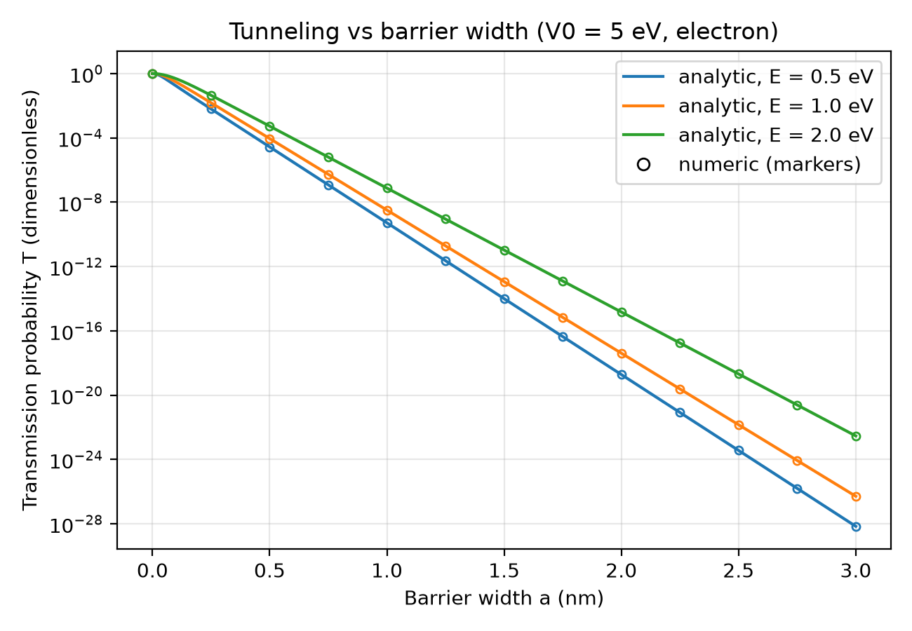
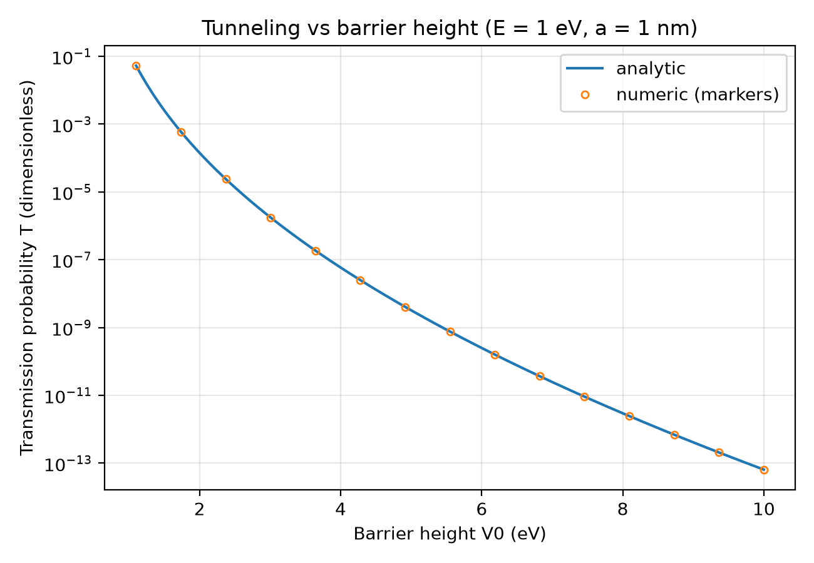
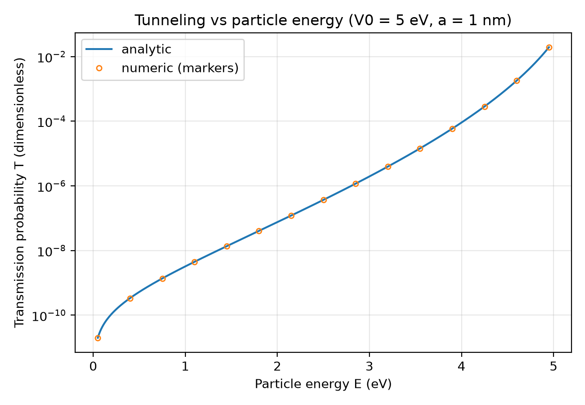
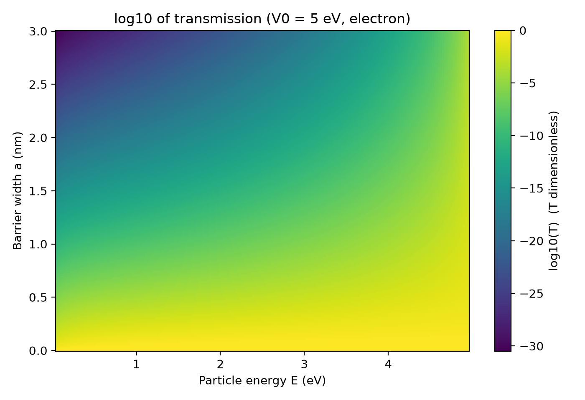
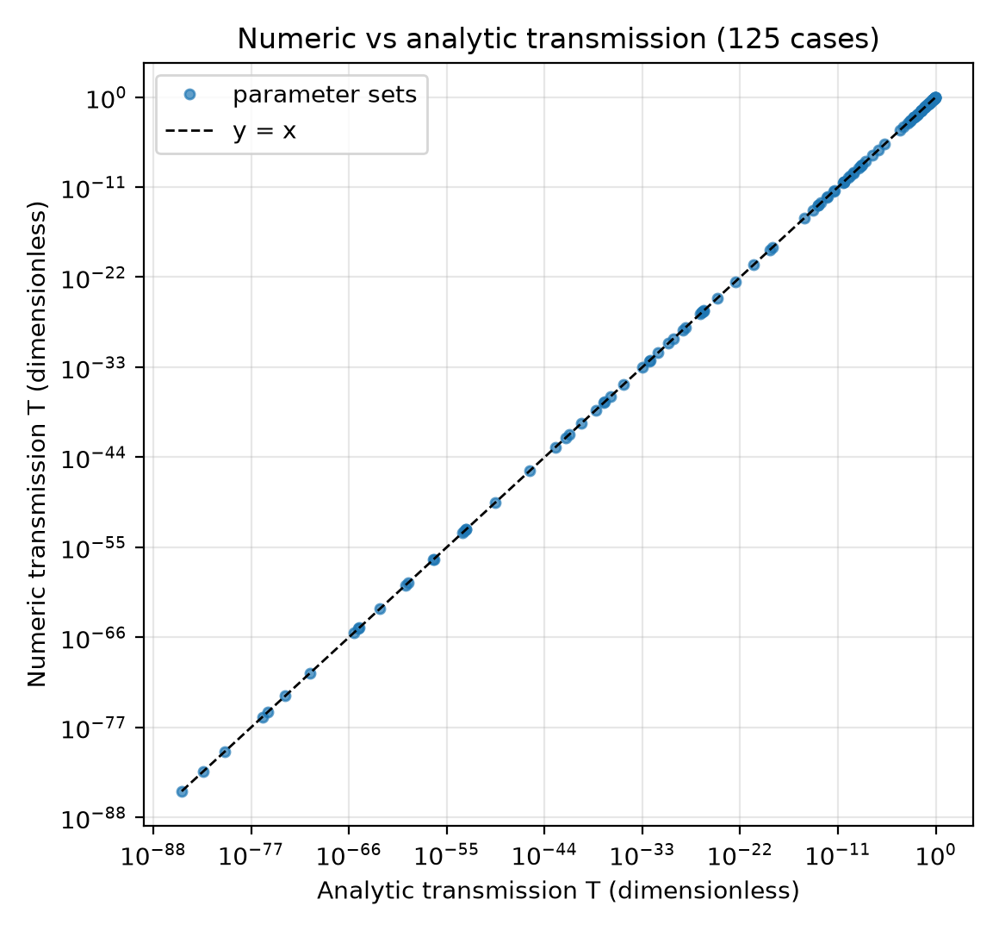
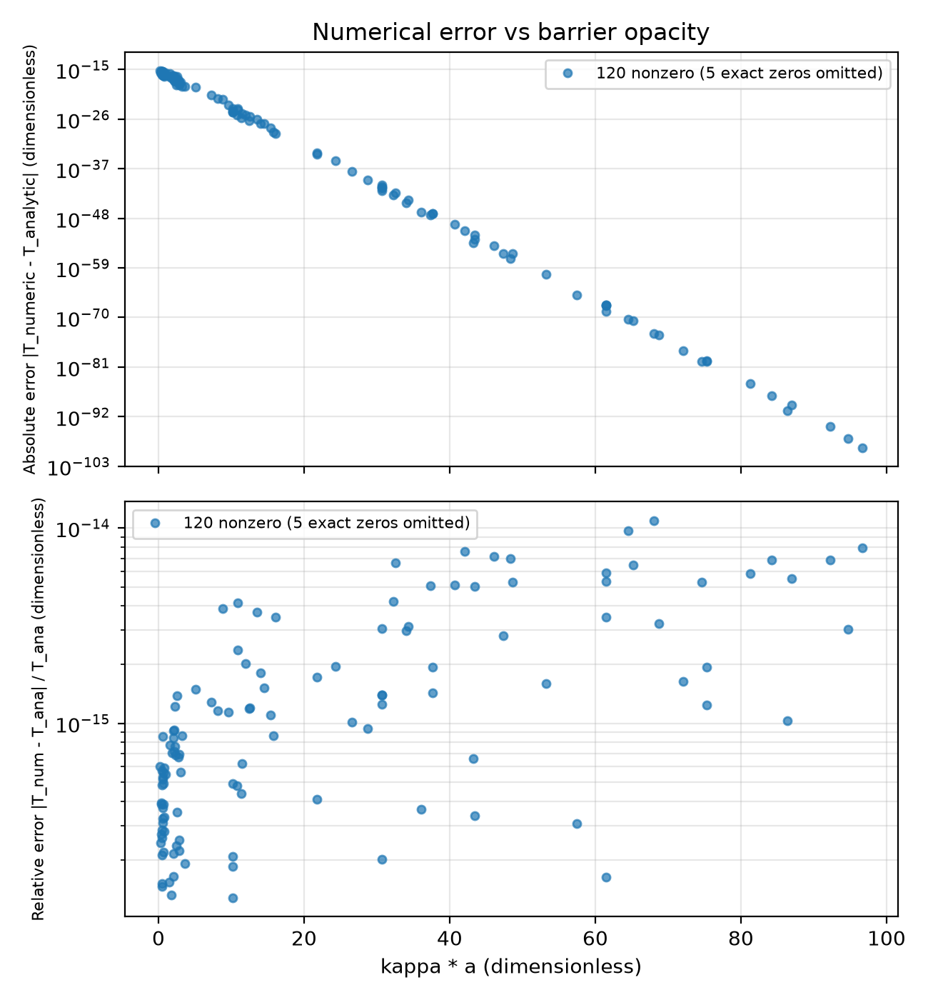

# quantum-tunelling-study

An independent computational investigation of quantum tunneling through a finite rectangular potential barrier. It is a study of a textbook problem using two implementations of the same model. It is not a novel discovery.

## Research question

How does the probability that an electron tunnels through a finite rectangular barrier change with the **barrier width**, the **barrier height**, and the **particle energy**, and do an analytic formula and a direct numerical solution of the boundary conditions agree across a range of parameters from thin to very thick barriers?

## Physics

A particle of mass *m* and energy *E* approaches a rectangular barrier of height *V0* and width *a* from the left, with 0 < *E* < *V0*. Classically it would always be reflected. Quantum mechanically the wavefunction penetrates the barrier, so there is a nonzero probability of finding the particle on the far side.

- Outside the barrier the wavefunction oscillates with wavenumber *k* = sqrt(2*mE*) / ħ.
- Inside the barrier it decays with

  **kappa = sqrt(2*m*(V0 − E)) / ħ**

- Wavefunction in the three regions (incident amplitude 1):
  - x < 0: exp(i*k*x) + *r* exp(−i*k*x)
  - 0 < x < a: *A* exp(kappa *x*) + *B* exp(−kappa *x*)
  - x > a: *t* exp(i*k*x)
- Matching ψ and ψ′ at x = 0 and x = a gives the exact transmission probability

  **T = [ 1 + V0² sinh²(kappa·a) / (4E(V0 − E)) ]⁻¹**

  and the reflection probability *R* = |*r*|², with *R* + *T* = 1.
- For a thick barrier (kappa·a ≫ 1): *T* ≈ 16E(V0 − E)/V0² · exp(−2·kappa·a).

**Assumptions**

- One spatial dimension.
- Non-relativistic (Schrödinger equation).
- A sharp rectangular barrier.
- A single electron (mass from `src/constants.py`).
- Plane-wave incidence from the left.
- Only the below-barrier case 0 < *E* < *V0*.

Internally everything is SI (J, m, kg). The user-facing inputs are eV and nm, converted by functions in `src/constants.py`.

## Project structure

```
app.py                  Streamlit app (sliders, T/R metrics, plots)
requirements.txt        Pinned dependencies
LICENSE                 MIT
src/
  constants.py          hbar, electron mass, elementary charge; eV<->J and nm<->m conversions
  analytic.py           transmission_analytic(E_eV, V0_eV, width_nm): closed form, computed in log space to avoid overflow
  numeric.py            transmission_numeric(...) -> (T, R): solves the 4x4 complex boundary-matching
                        system with numpy.linalg.solve; wavefunction_numeric(...) for |psi|^2 plots.
                        Does not import analytic.py.
  sweeps.py             Compares the two methods on a fixed 5 x 5 x 5 grid; writes results/comparison.csv
  plots.py              Generates the six figures in results/figures/
tests/
  test_constants.py     test_analytic.py   test_numeric.py
  test_sweeps.py        test_plots.py      test_app.py
results/
  comparison.csv        Output of src.sweeps
  figures/              fig1 ... fig6 (PNG, 200 dpi)
report/                 Placeholder (currently empty)
```

## Setup (Windows, Python 3.12)

From the repository root in PowerShell:

```powershell
py -3.12 -m venv .venv
.venv\Scripts\Activate.ps1
python -m pip install -r requirements.txt
```

If PowerShell refuses to run the activation script, either allow it for the current session with `Set-ExecutionPolicy -Scope Process -ExecutionPolicy Bypass`, or skip activation and call `.venv\Scripts\python.exe` directly in place of `python` below.

Run every command below from the repository root.

## Usage

**Tests**

```powershell
python -m pytest
```

**Parameter sweep**: compares the analytic and numeric methods and writes `results/comparison.csv`:

```powershell
python -m src.sweeps
```

**Figures**: writes six PNGs to `results/figures/` (reads `results/comparison.csv`, creating it if missing):

```powershell
python -m src.plots
```

**Streamlit app**:

```powershell
python -m streamlit run app.py --server.port 8765
```

Then open http://localhost:8765. The sidebar has sliders for E (0.05–10 eV), V0 (0.1–10 eV) and width (0.05–5 nm). If E ≥ V0 the app shows a warning instead of computing. It displays T from both methods, their absolute difference, R, kappa (1/nm) and kappa·a. It also draws T against width with a marker at the current width, and the probability density |ψ|² across the three regions.

## Results

All numbers below come from `results/comparison.csv`, produced by `python -m src.sweeps`.

**Sweep design (fixed in advance, not tuned):** 125 combinations, all with 0 < E < V0.

| Parameter | Values |
|---|---|
| Energy E (eV) | 0.1, 0.5, 1, 2, 4 |
| Barrier height V0 (eV) | 4.5, 5, 6, 8, 10 |
| Width (nm) | 0.05, 0.2, 1, 3, 6 |

**Agreement between the numeric and analytic transmission:**

| Quantity | Value |
|---|---|
| Combinations | 125 |
| Max absolute error | 5.55e-16 |
| Mean absolute error | 4.28e-17 |
| Max relative error | 1.09e-14 |
| Mean relative error | 1.87e-15 |
| Largest kappa·a tested | 96.72 |
| Smallest kappa·a tested | 0.181 |
| Smallest T_analytic in the sweep | 1.55e-85 |

- The largest relative error is at E = 0.1 eV, V0 = 5 eV, width = 6 nm (kappa·a = 68.04). There T is about 2.48e-60 for both methods, and they agree to about 14 significant digits.
- In 5 of the 125 rows the absolute error is exactly 0. These cannot be shown on a log axis and are omitted from Figure 6.
- The relative error is defined as |T_numeric − T_analytic| / T_analytic. The analytic value is the denominator because it was derived independently of the linear solve, not because it is guaranteed more accurate.
- Other tests confirm R + T = 1 to within 1e-10 for the numeric solution, T decreasing monotonically with width, 0 ≤ T ≤ 1, and agreement with the thick-barrier approximation for kappa·a above about 10 (within a relative tolerance of 1e-6 for the cases tested).

### Figures

**Figure 1.** Transmission vs barrier width for E = 0.5, 1 and 2 eV (V0 = 5 eV), log y-axis. Lines are analytic; markers are numeric.



**Figure 2.** Transmission vs barrier height (E = 1 eV, width 1 nm).



**Figure 3.** Transmission vs particle energy (V0 = 5 eV, width 1 nm).



**Figure 4.** Heatmap of log10(T) against energy and width (V0 = 5 eV).



**Figure 5.** Numeric vs analytic transmission for the 125 sweep cases, log-log axes with a y = x reference line.



**Figure 6.** Absolute and relative numerical error against kappa·a.



## Limitations

- **Agreement validates the implementation, not the physics.** The numeric and analytic methods solve the same boundary-value problem for the same model. Their agreement checks the algebra and the code. It does not show that the rectangular-barrier model describes any real system.
- **Below-barrier case only.** The code requires 0 < E < V0 and raises `ValueError` otherwise. E = V0 and E > V0 use different formulas and are not implemented.
- **Idealised barrier.** A sharp, one-dimensional, rectangular barrier with a single non-relativistic electron and plane-wave incidence. There is no barrier-edge smoothing, no image-charge effect, no effective mass and no many-body effects.
- **Precision limit for very thick barriers.** T falls exponentially with kappa·a. For double precision, T underflows to 0 once kappa·a is a few hundred. The sweep only reaches kappa·a ≈ 97 (T ≈ 1e-85), so behaviour of the numeric solver beyond that has not been tested. The analytic function works in log space, so it does not overflow, but its output still underflows to 0 for such barriers.
- **Sweep coverage.** The sweep has E/V0 ≤ 0.89 and a fixed 5 × 5 × 5 grid. It does not probe E very close to V0.
- **Electron mass is fixed.** The code does not take the particle mass as a user input in the public functions.

## Known issues

- **Transient Matplotlib mathtext errors in the Streamlit terminal.** Moving the sliders quickly can start overlapping script reruns in different threads. Matplotlib's mathtext parser (used for log-axis tick labels) is not thread-safe, which previously printed `ParseFatalException: Unknown symbol: \mathdefault` and `ParseException` tracebacks in the terminal. `app.py` now builds and renders each figure while holding a module-level lock and uses `matplotlib.figure.Figure` rather than pyplot global state. A thread-stress test (`tests/test_app.py`) covers this. I have not confirmed in a long interactive browser session that the messages never appear. If you still see them, they are transient and the app should recover on the next rerun.
- `src/` modules import each other with flat imports (for example `from constants import ...`). `sweeps.py`, `plots.py`, `app.py` and the tests add `src/` to `sys.path` to make this work, so the modules are not packaged for use as an installed library.

## My contributions and AI use

- **What I did:** [Describe your own contribution here: for example, defining the research question, choosing the sweep parameters, reviewing the results, and running the code.]
- **What AI tools did:** [State honestly which AI tools were used and for what, for example writing code, tests, plots, the Streamlit app, or this README.]
- **How I checked the AI-assisted work:** [Describe how you verified it, for example reading the code, running the tests, comparing with the textbook formula, or inspecting the figures.]
- **What I understand and can explain:** [List the parts you can explain yourself, for example the derivation of T, the meaning of kappa, and why the two methods agree.]

## References

- D. J. Griffiths, *Introduction to Quantum Mechanics* (Pearson / Cambridge University Press): the finite-barrier tunneling problem.
- CODATA 2022 recommended values of the fundamental physical constants (NIST): the values for ħ (computed as h/2π), the electron mass and the elementary charge used in `src/constants.py`.

## License

MIT. See `LICENSE`.
